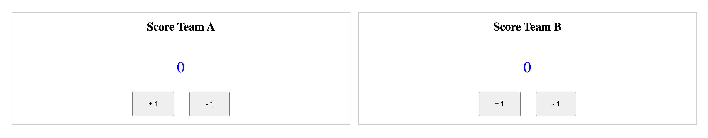
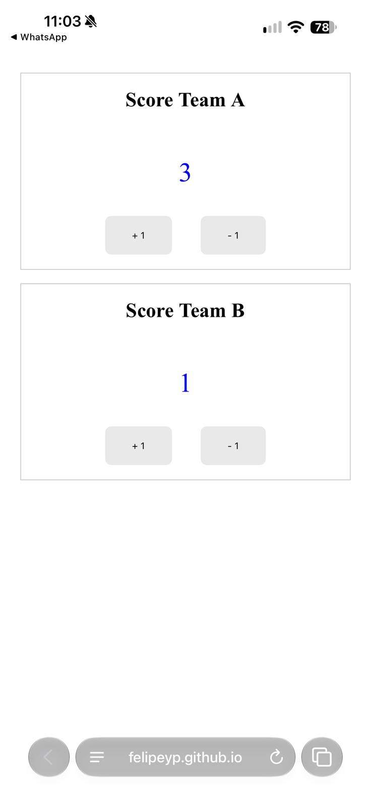

# Game Scorer
Live at: https://felipeyp.github.io/Game-Scorer/

A small, mobile-friendly web scoreboard for keeping score in games with two teams. Tap a button to add or remove a point. The score survives a page refresh.




> **Status:** Core scoring works. Known gaps are listed under Current limitations.

## Why I Built It

Often, when playing games with friends, we forget how many points each one made, which makes us lose focus on the actual game, so I decided to create a simple game scorer to solve that problem and allow us to fully concentrate on the game. This was also a good practice for me to get better at HTML, CSS and JavaScript. 

## Features

- Two scoreboards, **Team A** and **Team B**, each with `+ 1` and `- 1` buttons
- Score never goes below 0
- Scores are saved in the browser (`localStorage`), so refreshing or closing the tab does not lose the match
- Responsive layout: scoreboards stack vertically on phones and sit side by side on screens 600px wide or more
- Accessibility basics: buttons have descriptive `aria-label`s, the scores use `aria-live="polite"` so screen readers announce changes, and buttons show a visible focus outline

## Tech stack

Plain HTML, CSS and JavaScript. No build step, no dependencies, no framework.

## Getting started

1. Clone the repository:
   ```bash
   git clone https://github.com/felipeyp/Game-Scorer.git
   cd Game-Scorer
   ```
2. Open `index.html` in any modern browser (double-click it, or serve the folder with any static server).

## Project structure

```
.
├── index.html   # Page markup: the two scoreboards and their buttons
├── script.js    # Score state, localStorage persistence, button handlers
└── styles.css   # Layout, responsive rules, focus styles
```

## How it works

- The whole match lives in one `match` object in `script.js`:
  ```js
  {
    teamA: { player1: {name, rank}, player2: {name, rank}, score },
    teamB: { player1: {name, rank}, player2: {name, rank}, score }
  }
  ```
- On load, `loadScore()` reads the saved match from `localStorage` (key `matchInfo`). If nothing is saved, or the saved data can't be parsed, the starting values are used. `showScore()` then renders both scores.
- `addScore(team)` and `deductScore(team)` update the score, save the whole `match` object back to `localStorage`, and update the displayed number.

## Current limitations

- **No reset button.** To start a new match, clear the site's data in the browser (or run `localStorage.removeItem('matchInfo')` in the console and refresh).
- **Player names and ranks are placeholders.** They exist in the data model (hard-coded as Fe, Ana, Joao, Maria, all rank "D") but are not shown or editable in the UI yet.
- **Per-browser storage.** The score is stored only in the browser on one device, so it does not sync across devices.
- No automated tests.

## Ideas for next steps

- Reset / new-match button
- Editable team and player names
- Editable number of players and teams
- Editable scoring rules for different games
- Match history

## Author

[felipeyp](https://github.com/felipeyp)

